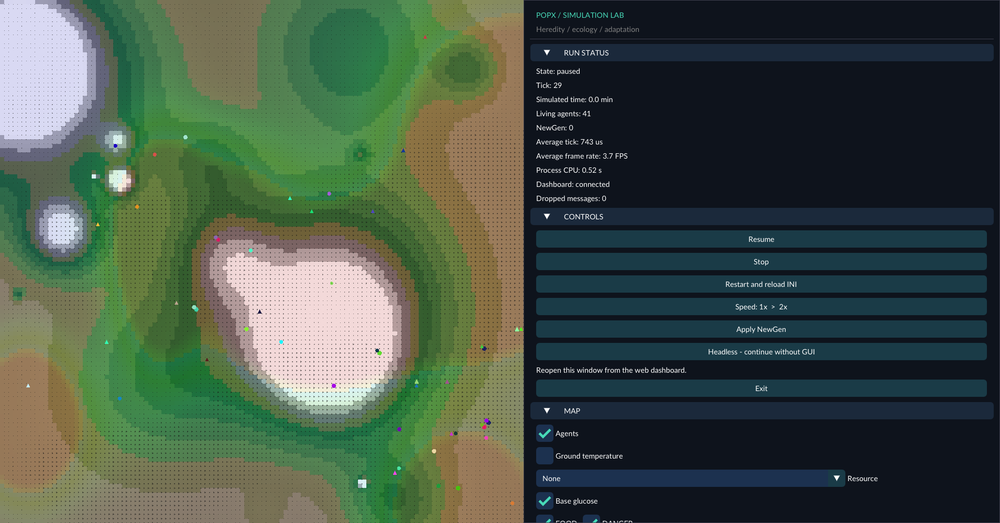
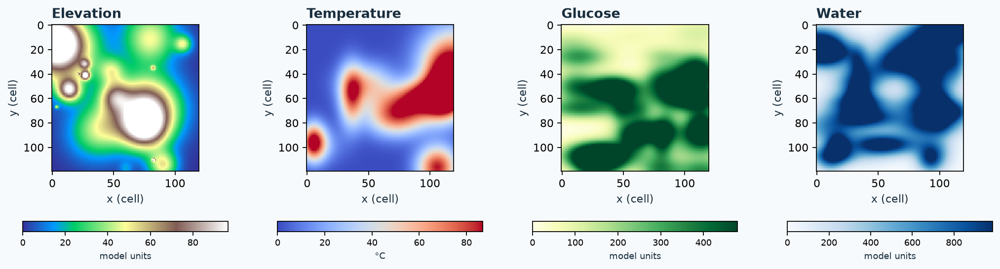
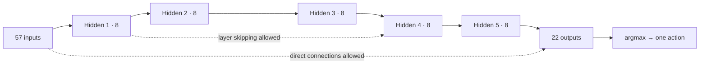
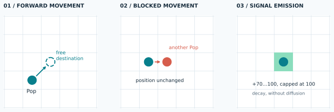
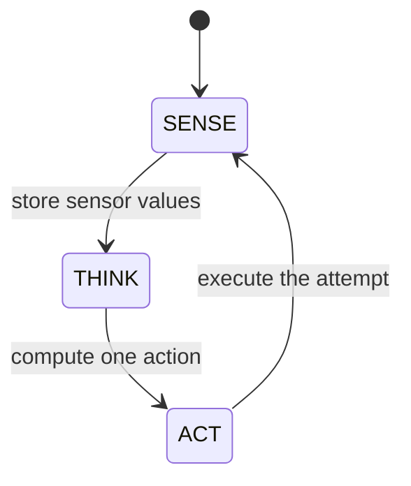
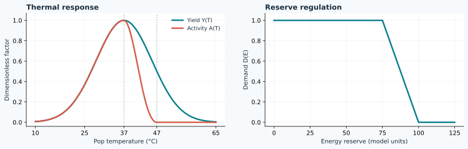
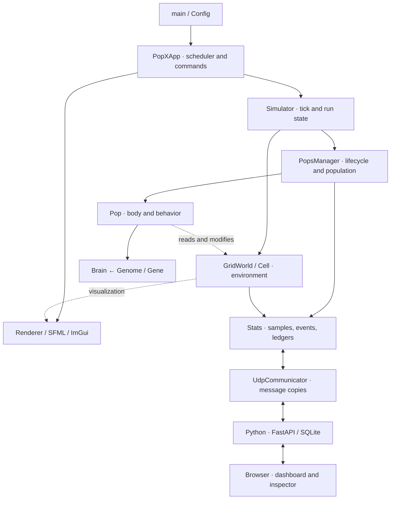

# PopX

PopX is an experimental C++ simulator of agents on a two-dimensional grid. Each agent
combines a genetically specified neural network with a simplified physiological model.
A Python dashboard provides run history, statistics, and individual inspection.

[Overview](#overview) · [Features](#features) · [The Pop](#pop) · [Mathematical model](#model) · [Getting started](#getting-started)



<a id="overview"></a>
## Overview

The project explores how inherited traits, individual learning, and local environmental
conditions affect agent behavior, survival, and reproduction.

Each individual, called a **Pop**, occupies a cell, reads local signals, and selects an action
through a neural network built from its genome. Movement changes access to resources; respiration
produces energy and heat; temperature affects metabolism; reproduction transfers part of the
parent's reserves to its offspring.

The simulator separates individual agents, the world they occupy, and the manager that controls
their lifecycle. Statistics and diagnostic tools help examine the relationships between genetic
encoding, decisions, physiology, and population changes.

The goal is to study adaptation without assuming that movement or aggregation is beneficial.
The model includes a physiological learning reward, explicit selection rules, and population
recovery interventions; these must be considered when interpreting results. Nearby agents or
regular trajectories alone do not demonstrate cooperation, useful learning, or evolution.

> **Project status.** This README describes the distributed configuration.
> [EVOLUTION_STATUS.md](docs/EVOLUTION_STATUS.md) is the reference for status, validation, and
> limitations. It also preserves historical audits, which do not automatically describe the
> current model. Evolutionary adaptation has not yet been demonstrated.

### Contents

| To understand… | Read |
|---|---|
| What can be simulated and observed | [Features](#features) and [the environment](#environment) |
| How an individual is created and makes decisions | [The Pop](#pop), [genome and brain](#brain), [state machine](#states) |
| The chemical reactions and numerical update rules | [Mathematical model](#model) |
| How C++ and Python fit together | [Architecture](#architecture) and [web service](#dashboard) |
| Where to find sources, tools, and credits | [Project structure](#structure) and [Acknowledgments](#acknowledgments) |
| How to build, run, and check the project | [Dependencies](#dependencies), [setup](#getting-started), and [validation](#validation) |

<a id="features"></a>
## Features

| Area | Implemented capabilities | Details |
|---|---|---|
| **Spatial environment** | Finite grid, one occupant per cell, Gaussian elevation, temperature, glucose, and water fields; limited local resources. | [World generation](#environment) |
| **Perception** | Position, boundaries, occupancy, temperature, glucose, chemical signals, age, and oscillator; directional scans. | [Sensors](#sensors) |
| **Neural decisions** | Sparse feedforward network, 1–6 hidden layers, connections that can skip layers, and a single action selected by argmax. | [Brain and genome](#brain) |
| **Actions** | Absolute/relative movement, resource intake and release, four signals, voluntary heating, and internal modulation. Optional forward attack. | [Key actions](#actions) |
| **Physiology** | Automatic uptake, probabilistic photosynthesis, respiration regulated by energy reserves, lipid insulation, thermal exchange, and energy costs. | [Reactions and temperature](#physiology) |
| **Learning** | Hebbian updates modulated by physiological reward, weight decay, and weight bounds. | [Plasticity](#learning) |
| **Heredity** | Asexual reproduction, whole-gene and physical-trait mutations, and learned-weight inheritance enabled in the distributed INI. | [Births and selection](#reproduction) |
| **Population lifecycle** | Births in nearby cells, bounded FIFO queue, deaths, optional NewGen selection, and hereditary extinction recovery in endless runs. | [Population dynamics](#reproduction) |
| **Runtime** | Pause, resume, stop, restart, 1×/2× speed and headless turbo, configurable simulated duration, and GUI/headless switching within the same run. | [Controls](#controls) |
| **Visualization** | SFML map, ImGui panel, resource, temperature, and pheromone layers; genetic colors and agent shapes. | [Reading the grid](#environment) |
| **Observability** | Samples and individual events, resource/energy ledgers, genealogy, censoring, performance, and transport gaps. | [Statistics](#statistics) |
| **Local dashboard** | SQLite history, charts, on-demand inspector, neural graph, manual snapshots, and an INI editor validated by the C++ binary. | [Python web service](#dashboard) |
| **Validation** | Standalone regressions, conservation audits, short pilots, and diagnostic thermal/strategy comparisons. | [Validation and methods](#validation) |

<a id="environment"></a>
## The world: a grid of resources and gradients

The distributed configuration creates **180 × 180 cells** and **80 founders**. The world is
initialized before agents spawn. Boundaries are closed: there is no toroidal wrapping.
Each cell contains elevation, temperature, chemical reserves, four pheromone intensities,
and a weak reference to its occupant, if any.



### Environment generation

Spatial fields are saturated sums of **Gaussian radial basis functions**. For each field:

$$
F(x,y)=\min\left(A_{\max},\sum_{k=1}^{N}
A_k\exp\left[-\frac{1}{2}\left(
\frac{(x-\mu_{x,k})^2}{\sigma_{x,k}^2}
+\frac{(y-\mu_{y,k})^2}{\sigma_{y,k}^2}\right)\right]\right),
\qquad A_{\max}=\max_k A_k.
$$

Centers, amplitudes, and widths are sampled randomly. Overlapping functions produce rich
patches, sparse areas, hills, and thermal gradients; saturation can create plateaus.

| Field | Gaussians | Characteristics |
|---|---:|---|
| Temperature | 10 | Anisotropic Gaussians; field recalculated every 1,000 ticks. |
| Elevation | 20 | Symmetric Gaussians with equal widths along both axes. |
| Glucose | 35 | Values converted to integer quantities and limited by cell capacity. |
| Water | 35 | Separate distribution from glucose, also integer-valued and capped. |

Oxygen, CO₂, lipids, and carbonate are initialized randomly per cell; nitrogen starts at zero.
During the run, the thermal field changes through small angular movements of Gaussian centers
around the map center, together with changes in their widths. This is not a model of heat
conduction between cells. An initial recalculation precedes subsequent 1,000-tick intervals.

### Reading the grid

- Terrain shading shows elevation; the **Ground temperature** control switches to thermal coloring.
- The **Resource** selector overlays temperature, glucose, water, O₂, CO₂, lipids, nitrogen, or calcium.
- Pops have a **genome-derived color**, useful as a visual cue but not as a genetic distance metric.
- A **triangle** indicates more chloroplasts than mitochondria; otherwise, a circle is drawn.
  The shape does not establish whether photosynthesis actually occurred during that tick.
- **FOOD, DANGER, MATE, HOME** layers display the four signal channels.
  Their names do not automatically assign a biological meaning to behavior.

Implementation: [GridWorld](src/grid_world.cpp), [Cell](src/cell.cpp),
[RBF generators](src/random_utility.cpp), [Renderer](src/renderer.cpp).

<a id="pop"></a>
## The Pop: body, genome, and decisions

A Pop is a persistent individual with an identity, an optional parent, a position, age,
energy, temperature, reserves, physical traits, a genome, and its own brain. Its history
includes action requests, successful movements, exchanged resources, reactions, and offspring.

### How an individual is created

A founder receives a random genome of **100–900 genes** and PHY traits sampled according to
the INI. Its brain is wired from that genome. The initial direction is selected from the eight
neighbors and is never the zero vector; a position is found among available cells.

| Component | Founder initialization in the distributed INI | Role |
|---|---|---|
| Energy | 100, absolute cap 400 | Reserve for maintenance, actions, and reproduction. |
| Temperature | 25 °C | Body temperature, distinct from cell temperature. |
| Reserves | Glucose 100, water 100, O₂ 20, CO₂ 0, calcium 0, lipids 20 | Substrates, exchange, and insulation. |
| Mitochondria | Integer from 1 to 25 | Maximum respiratory capacity per tick. |
| Chloroplasts | Integer from 0 to 25 | Photosynthesis eligibility and probability. |
| Adipose capacity | 80 | Limit for automatic lipid uptake. |
| `sensitiveness` | Integer from 1 to 6 | Inherited initial radius for spatial sensing; action 20 can increase the effective radius, up to the configured maximum (hard cap 12). |

PHY traits are inherited and mutated **separately from neural genes**. The random `lazyness`
factor limits climbable elevation differences; it is not a probability of skipping an action.
Offspring receive reserves from their parent: the founders' initial endowment is not added
to that donation. Extinction recovery uses recent distinct dead agents as donors when available;
these forced births are recorded separately.

<a id="brain"></a>
### From genome to brain

A gene describes a candidate connection:

$$
g=(\tau_s,i_s,\tau_d,i_d,w_{\mathrm{int}}),
\qquad w=\frac{w_{\mathrm{int}}}{8192}.
$$

| Field | Encoding |
|---|---|
| Source/destination type | `0` = sensor, `1…6` = hidden layer, `7` = output. |
| Neuron index | `uint32_t`; the generation domain depends on configuration. |
| Weight | `int16_t`, from −32768 to 32767; real-valued weight from −4 to approximately +4. |

With the INI's automatic domains, source indices are sampled from `0…56` and destination
indices from `0…21`. Each gene is then checked against its actual layer: an index valid for
a sensor may exceed the width of a hidden layer.

The distributed network has **57 inputs, 5 hidden layers of 8 neurons, and 22 outputs**:



Connections can go from an earlier layer to a later one, including nonadjacent layers.
Each individual implements only the connections encoded by its genes.
There are no recurrent connections or explicit biases. Duplicate connections are summed in
the sparse matrix. Genes whose indices exceed layer dimensions remain silent, without modulo
wrapping; genes with incompatible types or ordering are not wired. Both categories are
preserved when the learned genome is reconstructed.

For layer $\ell$, the forward pass is:

$$
\mathbf h^{(0)}=\mathbf s,\qquad
\mathbf h^{(\ell)}=\sigma\left(\sum_{k<\ell}W_{\ell k}\mathbf h^{(k)}\right),
\qquad \sigma(z)=\frac{1}{1+e^{-z}}.
$$

$$
a=\operatorname*{arg\,max}_{j}h_j^{(H+1)}.
$$

An output with no contributions has value $\sigma(0)=0.5$. A network with no decisive
output, including an exact tie, selects the explicit `DO_NOTHING` action (index 21).

Mutation replaces **the entire gene**, with probability `point_mutation_rate=0.01` per gene.
If a gene is not replaced, a separate 5% chance adjusts its weight by at most 256 quantization
steps. Increasing input or output dimensions does not implement
new sensors or actions, and does not automatically rewire living individuals.

Code: [Gene](src/gene.h), [Genome](src/genome.cpp), [Brain](src/brain.cpp).

<a id="sensors"></a>
### What a Pop perceives

A Pop evaluates the sensors connected to its brain. Directional scans read up to the Pop's **effective sensing radius**
to the north, west, east, and south, stopping at boundaries. Many values are normalized to
$[0,1]$; the previous direction is encoded from the actual integer displacement.

| Indices | Information |
|---|---|
| `0–4` | Position and distance to boundaries. |
| `5` | Birth-genome similarity to the living Pop immediately ahead; 0 when empty. |
| `6–7` | Components of the previous displacement. |
| `8–11` | Occupancy density in the four directions. |
| `12–19` | Directional mean temperature and difference from the current cell. |
| `20–23` | Local FOOD, DANGER, MATE, and HOME intensity. |
| `24–27` | Mean FOOD, DANGER, MATE, HOME concentration in the surrounding square, excluding the current cell. |
| `28–31` | Oscillator, normalized age, current cell temperature, random value. |
| `32` | Last movement attempt failed (1) or succeeded/not attempted (0); old 49-input checkpoints retain zero. |
| `33–36` | Directional glucose density. |
| `37–48` | DANGER, MATE, and HOME gradients, four directions each. |
| `49–56` | Passability of the eight movement destinations at the current stride. |

The gradient is a normalized difference between the scan average and the local value:
$g=\operatorname{clip}_{0,1}(0.5+0.5[\bar f_{\mathrm{dir}}-f_{\mathrm{here}}])$.
It is not a continuous derivative. Energy and **body** temperature affect physiology and reward,
but have no dedicated direct inputs in the current sensor list.

<a id="actions"></a>
### Key actions



| Outputs | Action | Effect |
|---|---|---|
| `0–7` | Forward, relative lateral, random, east/west/north/south | Attempts movement; costs 0.01 energy even when unsuccessful. |
| `8–11` | Emit FOOD/DANGER/MATE/HOME | Adds 70–100 units to the current cell, capped at 100. |
| `12–17` | Take/release glucose, water, calcium | Up to 10 units, subject to cell availability and capacity. |
| `18` | `BURN_CALORIES` | Costs 0.05 energy and adds 0.5 to the tick's thermal contribution. |
| `19` | `SET_OSCILLATOR_PERIOD` | Multiplies the period by 1.1, clamping it between 10 and `steps_per_generation` (at least 10). |
| `20` | `SET_RESPONSIVENESS` | Increases movement responsiveness by 0.001 (up to 2) and effective sensing radius by one cell (up to the configured maximum, hard cap 12). |
| `21` | `DO_NOTHING` | Waits without action cost. Included in the standard 22 outputs. |
| `22` | `KILL_FORWARD` | Kills the agent at the forward position; requires `brain_size_y=23`. Does not directly transfer its reserves to the attacker. |

Reproduction is not a brain output: physiological conditions request it, and `PopsManager`
handles it. Automatic resource uptake continues even when a Pop chooses other actions.
Every active output other than `BURN_CALORIES` costs 0.01 energy per attempt, including
resource transfers when the cell has none to give, emissions at the pheromone cap,
internal adjustments at their limits, and attacks without a target. `DO_NOTHING` is free.
The dashboard separates movement, other active actions, and thermoregulation costs.

With previous direction $\mathbf d=(d_x,d_y)$ and responsiveness $\rho$, requested relative
displacements are $\rho\mathbf d$, $\rho(-d_y,d_x)$ for `MOVE_LEFT`, and
$\rho(d_y,-d_x)$ for `MOVE_RIGHT`. On the grid, **y increases southward**; these names follow
the implemented transformations. Coordinates are integers: responsiveness does not create
subcell motion. `MOVE_RANDOM` samples each component from $\{-1,0,1\}$, including a zero move.

The destination must be inside the grid, unoccupied, free of a saturated carbonate barrier,
and satisfy:

$$
h(\mathbf p')-h(\mathbf p)<6(1-\lambda),
\qquad \lambda=\texttt{lazyness}\in[0,1].
$$

Here $h$ is the elevation returned by the world API, currently truncated to an integer.
The check uses the elevation difference between origin and destination, not slope divided
by distance; it does not check intermediate cells. Direction is updated from the successful
displacement without normalization. Requests, attempts, and actual movements therefore have
separate counters.

<a id="states"></a>
### State machine and execution order



Pops are distributed across three buckets that rotate every tick. Once the cycle is established,
an individual completes `SENSE → THINK → ACT` in **three ticks**, or 30 simulated ms.
An internal guard prevents a founder or newborn from thinking or acting before completing
the preceding phases, even if initially assigned to a bucket other than SENSE.

Each global tick follows this order:

1. **Sense**, then **think**, for their respective buckets; each phase finishes before the next.
2. Sequential **act**: movement, emissions, exchanges, and attacks write to the world.
3. **Physiology for all living agents**, age increment, death checks, and learning.
4. Dead-agent removal, reproduction queue processing, and bucket rotation; NewGen when scheduled.
5. Cell updates: decay, regeneration, and the thermal field.

Physiology runs **every tick**, not once per action. After the first THINK, Hebbian learning
can also run every tick, reusing the latest activations until they are recalculated. It should
not be interpreted as a single update associated exclusively with the latest ACT.

Sense and think use TBB within `num_threads` (4 in the INI, 1 for serial execution).
Actions, physiology, and the environment are sequential. Code: [Pop](src/pop.cpp),
[PopsManager](src/pops_manager.cpp), [Simulator](src/simulator.cpp).

<a id="model"></a>
## Mathematical model

The reaction equations below give the balanced chemistry of photosynthesis and aerobic
respiration. PopX represents these processes with integer resource units and simplified
reaction counts rather than molecular stoichiometry. The numerical update rules describe
that implementation; energy and heat use simulator units, and temperature is expressed in °C
without a calibrated heat capacity.

| Symbol | Meaning |
|---|---|
| $t$, $\Delta t$ | Global tick; $\Delta t=0.01$ simulated seconds. |
| $G,W,O,C,K,L$ | Reserves of glucose ($\mathrm{C_6H_{12}O_6}$), water ($\mathrm{H_2O}$), oxygen ($\mathrm{O_2}$), carbon dioxide ($\mathrm{CO_2}$), calcium carbonate ($\mathrm{CaCO_3}$), and lipids. |
| $E,T,T_e$ | Energy, Pop temperature, and its cell's temperature. |
| $M,P$ | Mitochondrion and chloroplast counts. |
| $\operatorname{clip}_{a,b}(x)$ | $\min(b,\max(a,x))$. |

The simulator's rate and exchange coefficients apply **per tick**: the update rules should
not be multiplied by $\Delta t$ again.
Order is part of the model: uptake → photosynthesis → respiration → temperature → payment
of costs → survival check → learning.

<a id="physiology"></a>
### 1. Exchange with the cell

Each tick, a Pop automatically requests $(5,5,5,5,2,1)$ units in the order $(G,W,O,C,K,L)$;
lipid uptake occurs only below adipose capacity. For resource $X$, environmental availability
$X_e$, cell capacity $X_{e,\max}$, and requested quantity $q$:

$$
\begin{aligned}
q_{\mathrm{in}}&=\min(q,X_e),&
(X,X_e)&\leftarrow(X+q_{\mathrm{in}},X_e-q_{\mathrm{in}}),\\
q_{\mathrm{out}}&=\min(q,X,X_{e,\max}-X_e),&
(X,X_e)&\leftarrow(X-q_{\mathrm{out}},X_e+q_{\mathrm{out}}).
\end{aligned}
$$

Voluntary actions add requests of up to 10 units of glucose, water, or calcium.
Only the accepted quantity is subtracted from the donor. Cell capacities are: glucose 500,
water 1,000, O₂ 1,000, CO₂ 1,000, lipids 300, carbonate 500; nitrogen has a cap of 2,000
but does not participate in Pop metabolism. There is no equivalent general cap on all internal reserves.

### 2. Probabilistic photosynthesis

The balanced net reaction for oxygenic photosynthesis is:

$$
6\,\mathrm{CO_2}+6\,\mathrm{H_2O}
\xrightarrow{\text{light}}
\mathrm{C_6H_{12}O_6}+6\,\mathrm{O_2}.
$$

In the simulator, a photosynthesis event can occur **at most once per tick**, provided
$P\geq10$, $C\geq1$, $W\geq1$, and cell elevation is at least 30.
Elevation serves as a light condition; no light flux is simulated.
Given those conditions:

$$
p_{\mathrm{photo}}=\min(P/14,1),\qquad
n_{\mathrm{photo}}\sim\operatorname{Bernoulli}(p_{\mathrm{photo}}).
$$

One implemented event consumes one model unit of carbon dioxide and one of water, producing
one unit of glucose and one of oxygen. These resource counts simplify the chemical coefficients
above. Oxygen is offered to the cell; any unaccepted oxygen stays in the Pop.
Photosynthesis does not directly add energy or heat to the implemented balance.

### 3. Regulated respiration

The balanced net reaction for aerobic glucose oxidation is:

$$
\mathrm{C_6H_{12}O_6}+6\,\mathrm{O_2}
\longrightarrow
6\,\mathrm{CO_2}+6\,\mathrm{H_2O}.
$$

Glucose oxidation releases energy. PopX represents this through energy and heat increments
for completed respiratory events.

Mitochondria set a **capacity**, not a mandatory consumption rate. Demand decreases as the
energy reserve approaches the target $E_*=100$, with demand band $b=25$:

$$
D(E)=\operatorname{clip}_{0,1}\left(\frac{E_*-E}{b}\right).
$$

Thermal yield is Gaussian; additional inhibition reduces activity on the hot side:

$$
\begin{aligned}
z&=\frac{T-T_*}{w},& T_*&=37\,^{\circ}\mathrm C,& w&=10\,^{\circ}\mathrm C,\\
Y(T)&=2^{-z^2},& h&=\operatorname{clip}_{0,1}(z),\\
I(T)&=1-3h^2+2h^3,& A(T)&=Y(T)I(T),\\
f_t&=M\,D(E_t)\,A(T_t).
\end{aligned}
$$



Fractional flux accumulates as credit $c_t$. When substrates and conditions allow:

$$
\widehat c_t=\min(M,c_t+f_t),\qquad
\widehat n_t=\min(\lfloor\widehat c_t\rfloor,G_t,O_t).
$$

Up to $\widehat n_t$ whole reactions are attempted; execution stops as soon as $E\geq E_*$.
Remaining credit is only the fractional part of $\widehat c_t$: unused whole reactions are
not carried forward. Substrate exhaustion, a satisfied energy target, or complete inhibition
resets the credit. Credit is not inherited.

At 47 °C, $Y(T)$ remains positive, while $A(T)$ and the requested flux are zero. For each
completed respiratory event, the implemented energy gain and heat contribution are:

$$
\Delta E=e_rY(T),\qquad q=q_r,
\qquad e_r=0.3,\quad q_r=0.3.
$$

The implementation consumes one model unit of glucose and one of oxygen and produces one
unit of carbon dioxide per event. Produced CO₂ is offered to the cell; any excess stays in
the Pop. Water production from the balanced chemical reaction is not implemented.
Unused capacity and incomplete reactions generate neither energy nor heat.
The reserve may exceed the target by less than the gain from one reaction.

### 4. Insulation and body temperature

Lipids reduce exchange with the environment:

$$
\alpha(L)=\operatorname{clip}_{\alpha_{\min},\alpha_{\max}}\left[
\alpha_{\max}-(\alpha_{\max}-\alpha_{\min})\min(L/L_{\mathrm{ref}},1)\right],
$$

with $\alpha_{\min}=0.01$, $\alpha_{\max}=0.5$, and $L_{\mathrm{ref}}=80$.
Let $n_r$ be completed respirations and $u_h\in\{0,1\}$ indicate the heating action:

$$
T_{t+1}=T_t+\alpha(L_t)(T_{e,t}-T_t)+0.3n_r+0.5u_h.
$$

The exchange term is a discrete relaxation toward ambient temperature. Production terms are
effective temperature increments, not joules. `BURN_CALORIES` consumes energy without directly
consuming a lipid token. Pop heat is not returned to the cell's thermal field through a
reciprocal reaction.

### 5. Energy, survival, and reserve return

Excluding reproductive transfers, which occur after physiology, the per-tick balance is:

$$
\widetilde E_{t+1}=E_t+0.3Y(T_t)n_r-0.02-0.01u_m-0.05u_h,
\qquad E_{t+1}=\min(400,\widetilde E_{t+1}),
$$

where $u_m=1$ if a movement request was executed, including a failed attempt. `Stats` separately
records energy lost to the cap and numerical roundoff.

Physiological death occurs when **energy ≤ 0**, **age > 200,000 ticks**, **temperature ≤ 10 °C**,
or **temperature ≥ 75 °C**. The age limit corresponds to roughly 33.3 simulated minutes.
Forward attacks and NewGen culling provide other removal paths.

At death, the six reserves are returned to the cell up to its capacity. Quantities that cannot
be accepted are accounted for as **overflow losses**; removed residual energy does not
automatically become environmental energy.

### 6. External dynamics: regeneration and signals

Two environmental Source agents spawn at random free cells. Each is a black,
light-bordered diamond, slightly larger than a Pop, and occupies its cell: Pop
and Source movement obey the same occupancy, calcium-barrier, and climb rules.
Sources attempt a step every 40 ticks, follow a curve whose curvature changes
randomly, and try alternative directions and curvatures when blocked. Their
movement and glucose output are independent: every 40 ticks each offers eight
units to each of the up to eight adjacent cells. Excess beyond a cell's capacity
floods into progressively more distant neighboring cells. Only accepted glucose
enters the material ledger; a fully saturated world discards the rest. At map
size 180 the interior theoretical input is 2 × 8 × 8 / 40 = 3.2 units per tick.
Initial glucose still follows the world RBF.

The INI controls source_count, source_move_interval_ticks,
source_glucose_interval_ticks, and source_glucose_per_neighbor. A larger
interval slows the corresponding activity; the offered glucose rate is
source_count × 8 × source_glucose_per_neighbor / source_glucose_interval_ticks
units per tick away from edges and saturation.

Cell oxygen continues to regenerate one unit every 1,000 ticks, with a randomized
initial phase and a cell capacity. Other resources have no equivalent regeneration.

Pheromones are additive fields per cell and channel $k$. After the tick's emissions:

$$
\widetilde F_{k,t}=\operatorname{clip}_{0,100}(F_{k,t}+\Delta F_{k,t}),\qquad
F_{k,t+1}=\begin{cases}
0 & \text{if }0.9995\,\widetilde F_{k,t}<0.01,\\
0.9995\,\widetilde F_{k,t} & \text{otherwise}.
\end{cases}
$$

There is no diffusion between cells. A trail can result from emissions at successive positions;
a single emission does not spread to neighboring cells. These channels do not consume any of
the chemical reserves.

The discrete update rules and resource accounting can be checked against [pop.cpp](src/pop.cpp),
[cell.cpp](src/cell.cpp), and [shared constants](src/common.h). Respiratory parameters, rationale, and validation are documented
in the [status reference](docs/EVOLUTION_STATUS.md).

<a id="learning"></a>
## Learning during an individual's lifetime

The brain updates existing weights using action eligibility and reward relative to a recent baseline:

$$
w_{ij}\leftarrow\operatorname{clip}_{-4,4}\left[
w_{ij}+\eta (r-b)e_{ij}-\delta\,\operatorname{sign}(w_{ij})\max(0,|w_{ij}|-1/8192)\right],
\qquad \eta=0.06,\quad\delta=3\times10^{-5}.
$$

The signal is clipped to [−1, 1]; the baseline follows reward at rate 0.01.
Traces decay by 0.97 per tick. Each executed action injects a factor of
$1-0.97^3$ times $a_i a_j(1-a_j)$ for its chosen output; hidden connections
retain the centered local product $(a_i-0.5)(a_j-0.5)$. Traces are bounded
by ±0.25. This is local credit, not policy-gradient training or backpropagation.
Only the selected output receives new credit. The rule does not add connections.
Learned weights are inherited; traces and reward baselines are reset at birth.

The reward combines five signals: age, energy reserve, energy change during physiology,
offspring, and proximity to the optimal temperature. The **effective weights**, after the
limits applied by the code, are:

$$
r=\operatorname{clip}_{-1,1}
\left(0.10s_a+0.30s_E+0.35s_{\Delta E}+0.05s_n+0.20s_T\right).
$$

<details>
<summary><strong>Reward signal definitions</strong></summary>

Let $a$ be age in ticks, $n$ the number of offspring, and $\Delta E_{\mathrm{phys}}$ the
energy difference between the end and the start of the physiological update:

$$
\begin{aligned}
s_a&=\operatorname{clip}_{0,1}(a/200000),\\
s_E&=\operatorname{clip}_{-1,1}\left[
\frac{\operatorname{clip}_{0,1}(E/400)-0.25}{0.75}\right],\\
s_{\Delta E}&=\operatorname{clip}_{-1,1}\left[
\frac{\Delta E_{\mathrm{phys}}}{\max(0.3\max(M,1),10^{-6})}\right],\\
s_n&=\operatorname{clip}_{0,1}(n/25),\\
s_T&=2\cdot2^{-((T-37)/10)^2}-1.
\end{aligned}
$$

The thermal reward uses the same Gaussian temperature profile as respiratory yield.
The energy term uses the physiological delta rather than every transfer between global ticks.
There is no term that directly rewards movement or aggregation.

</details>

With `hebbian_inheritance=true`, enabled in the distributed INI, the child's genome is
reconstructed from learned weights, quantized into the integer encoding, and then mutated.
Unexpressed genes are preserved; duplicate connections in the original genome may be consolidated.
The reconstructed genome's length therefore need not match the founder's. Without Hebbian
inheritance, a copy of the parent's original genome is mutated instead.

<a id="reproduction"></a>
## Reproduction and population dynamics

Reproduction is currently **asexual**. A living Pop is naturally eligible when $E>50$,
age $>1000$ ticks, and $G>20$. The manager searches the shuffled eight neighboring cells for
an available location, then a second ring if the first is full. A FIFO queue bounds the work:
the INI allows 3 attempts per tick and up to 64 queued candidates. Births stop at the
configured limit of 360 living Pops.

Once spawning succeeds, the parent first pays $c_r=0.3$ energy. It then transfers one eighth
of its reserves to the child:

$$
\begin{aligned}
E'&=E_{\mathrm{parent}}-c_r,&
E_{\mathrm{child}}&=E'/8,& E_{\mathrm{parent,new}}&=7E'/8,\\
X_{\mathrm{child}}&=\lfloor X_{\mathrm{parent}}/8\rfloor,&
X_{\mathrm{parent,new}}&=X_{\mathrm{parent}}-X_{\mathrm{child}},
\end{aligned}
$$

for $X\in\{G,W,O,C,K,L\}$. The cost is dissipated; the donation transfers existing reserves.
If no cell is available, neither this cost nor this donation is applied. PHY traits are copied;
each can change by $\pm1$ within its limits, with the configured mutation probability.

### Natural births, interventions, and NewGen

| Mechanism | Behavior | Interpretation |
|---|---|---|
| Natural birth | Meets physiological thresholds, pays the cost, and receives parental resources. | Offspring produced under the run's conditions. |
| Extinction recovery | Endless mode only: introduces up to 20 forced descendants from an archive of recent, distinct dead agents; uses random founders only if the archive is empty. The world and tick counter continue. | Archived donors retain genealogical continuity across extinction; recovery events remain distinguishable from natural births. |
| NewGen | Periodic or manual selection; keeps the highest scores $S=n_{\mathrm{offspring}}+0.01E$. | Model-imposed culling, distinct from environmental mortality. |

In the distributed INI, periodic NewGen is disabled. When enabled, its interval is **50,000 ticks**;
it keeps approximately **90%** of living agents and at least 8 survivors when available.
Survivors retain their identity, position, occupancy, order, and cycle phase. The NewGen
counter does not measure genealogical depth.

<a id="statistics"></a>
## Statistics and interpretation

`Stats` is the central collector: an initial sample, samples every **200 ticks**, and a final
sample, together with individual founder, birth, death, culling, and survivor-censoring events.
It retains completed-lifetime counters without keeping dead agents in memory.

| Measurement | Required distinction |
|---|---|
| Movement | Requested action, attempt, success, and distance traveled are different quantities. |
| Resources and energy | Intake, release, transformations, transfers, regeneration, caps, and losses have separate entries. |
| Reproduction | Founders, natural births, forced births, recovery seeds, and offspring per parent are distinct. |
| Survival | A mean over living agents does not describe completed lifetimes; survivors at the end of observation are censored. |
| Performance | Simulated time, wall time, tick/frame latency, and process-wide CPU time are not interchangeable. |

Ledgers follow
$\Delta\text{stock}=\text{inputs}-\text{outputs}+\text{transformations}+\text{roundoff}$.
Regeneration, founders, and recovery seeds are explicit inputs; the system is not presented
as a closed ecosystem. A correct balance checks the model's accounting, not the molecular
conservation of real biochemistry.

Local telemetry uses UDP with fragmentation, acknowledgments after SQLite commits, retries,
and deduplication. Queues and retries are bounded: the simulation continues without a backend,
but **explicit gaps** may appear. Cumulative counters can realign aggregates without recovering
every lost event. A run with gaps is not a complete audit.

<a id="architecture"></a>
## Technical architecture



| Component | Responsibility |
|---|---|
| [main / Config](src/main.cpp) | CLI, INI loading, schema, and validation. |
| [PopXApp](src/popx_app.cpp) | Application loop, 1×/2× and headless turbo scheduling, commands, and GUI creation/destruction. |
| [Simulator](src/simulator.cpp) | Authoritative 64-bit tick, running/paused/finished state, agents → environment ordering. |
| [PopsManager](src/pops_manager.cpp) | Owns Pops through `shared_ptr`; manages buckets, births, deaths, and selection. |
| [Pop](src/pop.h) | Sensors, actions, physiology, learning, and individual state; owns its brain through `unique_ptr`. |
| [Brain / Genome / Gene](src/brain.h) | Sparse matrices and activations, connection encoding, and heredity. |
| [GridWorld / Cell](src/grid_world.h) | Space and resources; cells observe occupants through `weak_ptr`. |
| [Renderer / SFML / ImGui](src/renderer.h) | Grid rendering and local controls. |
| [Stats / UdpCommunicator](src/stats.h) | Central collection and bidirectional transport. The worker handles copies without accessing living Pops. |
| [Python dashboard](dashboard/server.py) | SQLite persistence, APIs, web pages, and command forwarding. |

`IWorld`, `IAgent`, `IBrain`, `IStats`, and the other `I*` interfaces separate contracts from
implementations. Ownership avoids cycles: the manager owns individuals, while the world
and Pops observe one another through weak references. The GUI runs on the thread coordinating
the simulation; concurrency does not permit arbitrary reads of agents during writes.

<a id="dashboard"></a>
## Python web service

The launcher starts a **FastAPI/Uvicorn** service alongside the simulator at
[`http://127.0.0.1:8000`](http://127.0.0.1:8000), with control and telemetry over loopback UDP
port `8001`. The backend is **the only SQLite writer**, using WAL mode. The browser receives
statistical updates through Server-Sent Events; Chart.js draws charts and Cytoscape.js renders
the neural graph. Assets are served locally after setup.

| Page | Capabilities |
|---|---|
| **Overview** | Select current or historical runs, control execution, and view charts by interval, events, and diagnostic results. |
| **Inspector** | Request the living-agent list, choose a Pop, and inspect its body, genome, sensors, actions, and brain connections. |
| **Configuration** | Read and edit the INI using the C++ binary's schema and validation; apply values at the next Start/Restart. |

Inspection is **manual**: each snapshot reports its acquisition tick. The graph shows weights,
signs, layers, available activations, and unexpressed genes without rerunning the brain.
If a Pop dies before the request, the service returns an error rather than presenting stale
state as current.

**Save snapshot** explicitly stores the neural snapshot at
`nnets_dir/run_id/pop_id/tick_snapshot_id.json` and indexes it in the database. It remains
available after death and restart. Statistics and diagnostics are persisted in **SQLite**;
JSON files are reserved for user-requested neural snapshots.

The database also contains the initial environment and provenance: INI, commit/diff, source
and binary hashes, compiler, and RNG limitations. Historical queries are paginated and series
are bounded. The editor preserves comments and unchanged lines, checks for external changes,
and saves atomically. Saving the INI does not alter the current run.

<a id="structure"></a>
## Project structure

```text
popx/
├── README.md                    # Project overview and setup
├── AGENTS.md                    # Repository working conventions
├── CMakeLists.txt
├── CMakePresets.json            # Debug / Release presets
├── cmake/                      # Toolchain, dependencies, formatting targets
├── config/
│   └── popx.ini                # Distributed configuration
├── src/
│   ├── main.cpp, popx_app.*    # Startup, scheduling, commands, optional GUI
│   ├── simulator.*            # Run state and tick
│   ├── pops_manager.*, pop.*  # Population and individual
│   ├── gene.*, genome.*       # Hereditary encoding
│   ├── brain.*, neuron.h      # Network, sensors, and actions
│   ├── grid_world.*, cell.*   # Environment
│   ├── renderer.*, sfml_graphic_engine.*, imgui_layer.*
│   ├── stats.*, udp_communicator.*
│   └── i_*.h, common.h, …     # Interfaces, constants, and utilities
├── dashboard/
│   ├── server.py              # HTTP/UDP backend and persistence
│   ├── provenance.py          # Run provenance
│   ├── diagnostics.py         # Receiver for diagnostic tools
│   ├── requirements.txt       # Pinned Python dependencies
│   └── static/                # Frontend and vendor assets after setup
├── scripts/                   # Launcher, regressions, audits, analysis, figures
├── tests/                     # Standalone C++ regressions and Python tests
├── tools/                     # C++ audit and diagnostic comparison harnesses
├── docs/
│   ├── EVOLUTION_STATUS.md    # Status, validation, and investigation archive
│   └── assets/                # README screenshot and figures
├── .devcontainer/             # Containerized development environment
├── build-release/             # Generated locally: binary at src/popx
├── .venv/                     # Generated by the Python service setup
└── data_out/                  # Local output: databases, audits, snapshots
```

This is a condensed tree. Builds, virtual environments, data, and generated vendor assets
are not sources to commit. Any local `old/` archive is outside the active implementation.

<a id="dependencies"></a>
## Dependencies

The current build targets **Linux x86_64 with Clang and C++23**. Versions below are required
or pinned by the repository; they are not a list of the latest available releases.

### C++ simulator

| Dependency | Version / source | Purpose |
|---|---|---|
| Clang and the C++ standard library | C++23 support; `/usr/bin/clang{,++}` paths in the toolchain | Compiling the simulator. |
| CMake, Ninja, Git | System tools; presets use Ninja | Configuration, builds, and dependency retrieval. |
| [SFML](https://www.sfml-dev.org/) | Requests 2.5, within the 2.x family; system package | Window, events, and 2D rendering. |
| X11 and OpenGL/Mesa | System development libraries | Linux display integration and graphics context. |
| [oneTBB](https://github.com/uxlfoundation/oneTBB) | System package | Parallel sense/think phases and concurrency limits. |
| [Eigen](https://libeigen.gitlab.io/) | 3.4.0, FetchContent | Sparse matrices and brain operations. |
| [nlohmann/json](https://github.com/nlohmann/json) | 3.11.3, FetchContent | Protocol payloads, INI schema, and neural snapshots. |
| [Dear ImGui](https://github.com/ocornut/imgui) | 1.89.9, FetchContent | GUI controls and panels. |
| [ImGui-SFML](https://github.com/SFML/imgui-sfml) | 2.6, FetchContent | Integration between ImGui and the SFML window. |

The headless binary is still linked against graphics libraries, but opens no window and does
not require `DISPLAY`. Versions and URLs are in [ThirdPartyLibs.cmake](cmake/ThirdPartyLibs.cmake).

### Dashboard and tools

| Dependency | Purpose |
|---|---|
| Python 3, `venv`, `pip` | Running and isolating the web service. |
| [FastAPI](https://fastapi.tiangolo.com/) 0.115.12, Uvicorn 0.34.2 | HTTP/SSE API and ASGI server. |
| Starlette, Pydantic, and transitive dependencies | ASGI infrastructure, data handling, and validation; versions are in the requirements file. |
| [SQLite](https://www.sqlite.org/index.html), through Python's `sqlite3` | Local storage, transactions, and run history; no separate database server. |
| [Chart.js](https://www.chartjs.org/) 4.4.9 | Browser charts. |
| [Cytoscape.js](https://js.cytoscape.org/) 3.31.2 | Interactive brain visualization. |
| HTTPX | Client used by backend integration tests. |
| NumPy and Matplotlib, optional | Audit plots and regeneration of README figures. |
| Pillow, optional | Window capture in GUI tests. |
| NetworkX, SciPy, and PyQt5, optional | Historical `plot_net.py` viewer; use the dashboard for current inspection. |

Web dependencies are pinned in [dashboard/requirements.txt](dashboard/requirements.txt).
Chart.js, Cytoscape.js, and their licenses are downloaded and SHA256-checked by
[setup_web_assets.py](scripts/setup_web_assets.py). Optional tools are not required to launch
the simulator and dashboard.

<a id="getting-started"></a>
## Getting started

### 1. Configure and build

From a Linux environment with the system dependencies already available:

```bash
git clone https://github.com/framorgi/popx.git
cd popx

cmake --preset "Application Release"
cmake --build build-release --target popx -j 2
```

The first CMake configuration uses the network for FetchContent. An `Application Debug` preset
is also available, with output in `build-debug`. Without presets:

```bash
cmake -S . -B build-release -G Ninja -DCMAKE_BUILD_TYPE=Release
cmake --build build-release --target popx -j 2
```

Use the explicit **`popx`** target: the default `all` target includes `format`, which can rewrite
sources through clang-format. The `EBABLE_CODE_FORMATTING` option currently does not disable
that target. The [development Dockerfile](.devcontainer/Dockerfile) also lists debugging and
analysis tools that are not essential to a minimal build.

### 2. Set up the web service and launch

The first full launch requires explicit setup of the virtual environment and web assets:

```bash
bash scripts/run_popx.sh --setup --build
```

Open **[`http://127.0.0.1:8000`](http://127.0.0.1:8000)** in a browser. Subsequent launches
neither install dependencies nor rebuild:

```bash
# World GUI and dashboard
bash scripts/run_popx.sh

# Dashboard with a headless simulation
bash scripts/run_popx.sh --headless

# 2× speed with a dedicated history database
bash scripts/run_popx.sh --headless --speed 2 --db data_out/experiment.sqlite
```

`--setup` requires network access; the launcher assumes an already configured CMake build and
available C++ dependencies. For all options:

```bash
bash scripts/run_popx.sh --help
```

### 3. Run the simulator on its own

```bash
# Without a dashboard or display
build-release/src/popx --headless --config config/popx.ini --speed 2

# Validation and schema, without initializing SFML
build-release/src/popx --validate-config config/popx.ini
build-release/src/popx --config-schema
```

Without a receiver, the simulation runs but telemetry is not archived. For a bounded standalone
run, set a positive duration in the INI; `Ctrl-C` terminates the process. The default INI path
is resolved relative to the executable. Configured `nnets_dir`, `log_dir`, and `image_dir`
paths are resolved relative to the INI directory.

<a id="controls"></a>
### 4. Control a run

The control and page names in this README are given in English; the current application
source also contains Italian UI labels. The screenshot uses a temporary English-labelled
build for documentation, as described in [figure provenance](#figure-provenance).

| Command / parameter | Effect |
|---|---|
| **Pause / Resume** | Stops/resumes progression; commands and the dashboard remain available. |
| **Speed 1× / 2×** | Requests 100 / 200 ticks per real second; each tick remains 10 simulated ms. Computation cost can reduce the achieved speed. |
| **Headless turbo** | Runs the same ticks in short batches without the 1×/2× wait when the GUI is hidden. |
| **Stop** | Ends the run while keeping the process available. |
| **New run** | After completion, reads the INI and creates a new world and population. |
| **Restart / reload INI** | Rebuilds the run, including while it is active. Invalid configuration leaves the previous run intact. |
| **Headless / Show GUI** | Destroys/recreates the window and graphics context within the same run. Show GUI requires an available display. |
| **NewGen** | Immediately applies the selection described above. |
| **Exit / Ctrl-C in the launcher** | Terminates the processes started by the launcher. |
| `max_duration_minutes=0` | Endless run with extinction recovery; world and tick progression remain continuous. |
| Positive duration | Ends at $\lceil6000\cdot\text{minutes}\rceil$ ticks; earlier extinction ends the run. |
| `gui_fps=30` | Rendering upper bound; the CPU budget may reduce the frame rate. |

For an initial comparison, use a copy of [config/popx.ini](config/popx.ini), passed through
`--config`, and a dedicated database. The distributed INI and the `Config` class defaults are
not necessarily identical.

<details>
<summary><strong>Present but inactive or limited parameters</strong></summary>

- `sexual_reproduction=true` does not enable sexual reproduction; the implementation is asexual.
- `gene_insertion_deletion_rate` and `deletion_ratio` do not implement production insertions/deletions.
- `choose_parents_by_fitness` does not select parents for the reproduction queue.
- `max_generations` does not determine when a run ends.
- `key@N` overrides are read and validated, but are not applied automatically during the run.
- `steps_per_generation` scales the age sensor and oscillator limit; it does not schedule births.
- `brain_serialization_enabled` is deprecated and inert; neural snapshots are saved manually.
- `sensitiveness` initializes `probe_dist_`, which sets the range of spatial scans; action 20 can increase it during life. Genetic similarity senses the living Pop immediately ahead.

</details>

<a id="validation"></a>
## Validation and experimental methods

Project checks are **standalone**, not a suite registered with CTest. The repository contains
no `utests/` directory; `ENABLE_UTESTS` and `UTESTS_ENABLED` are different flags.

```bash
# C++ invariants: respiration, lifecycle, parallelism/space, genome, pheromones, stats/runtime
bash scripts/run_regressions.sh

# Python service protocol and integration, after setup
.venv/bin/python -m unittest tests/dashboard_protocol.py tests/dashboard_integration.py -v

# Resource balances and a short pilot: SQLite output
bash scripts/run_audit.sh /tmp/conservation.sqlite probes
bash scripts/run_audit.sh /tmp/pilot.sqlite 2000

# Diagnostic comparison of the current physiology
bash scripts/run_thermal_comparison.sh /tmp/moderate.sqlite moderate
```

These are repeatable commands, not a claim that every suite was rerun for this README.
Validation results, conditions, and limitations are recorded in
[EVOLUTION_STATUS.md](docs/EVOLUTION_STATUS.md).

An experiment should retain its configuration, commit and diff, initial environment, genomes,
traits, backend/build, and RNG information. Production randomness uses noncentralized
`random_device` and `rand`; a single seed does not guarantee global replay. Deterministic
fixtures and imposed diagnostic policies help isolate mechanisms; they do not automatically
provide evidence of adaptation in a freely evolving population.

Attributing an advantage to movement or a trait requires controlled comparisons that distinguish
resource access, thermal exposure, age, censoring, forced interventions, and selection.
Short pilots mainly check mechanics and accounting; they do not establish an evolutionary effect.

<a id="figure-provenance"></a>
<details>
<summary><strong>Figure provenance and regeneration</strong></summary>

The screenshot was captured from the window of a PopX process started for documentation.
A temporary build of commit `f6b6fbd` translated only the string literals in `imgui_layer.cpp`
into English; the normal executable and production sources were left unchanged. It used the
distributed INI without physiological overrides. Run `1792104090042594827-1317952614` supplies
both the GUI capture and the initial fields shown above.
The capture shows a 120 × 120 grid paused at tick 29 with 41 living agents. The environment
maps show tick-0 values with independent scales. The action diagram is schematic, with
responsiveness equal to 1; respiratory curves are analytical evaluations of the INI parameters.

Capture uses [tests/capture_window.py](tests/capture_window.py), requiring X11 and Pillow.
The database and UI translation patch are retained locally at
`data_out/audit/readme_english_f6b6fbd/`, excluded from Git. The ready-to-view figures are
included in the repository.

Regenerate the action illustrations and respiratory curves with:

```bash
python3 scripts/render_readme_figures.py

# Produce maps from another archived run with a complete initial environment:
python3 scripts/render_readme_figures.py --environment-db data_out/popx.sqlite
```

The script requires NumPy/Matplotlib, reads SQLite in read-only mode, and does not export
statistical JSON. `--run-id` selects a specific run; otherwise it uses the latest one.
A new environment does not reproduce the original screenshot: update images and provenance together.

</details>

<a id="acknowledgments"></a>
## Acknowledgments

PopX uses [SFML](https://www.sfml-dev.org/), [Dear ImGui](https://github.com/ocornut/imgui),
[ImGui-SFML](https://github.com/SFML/imgui-sfml), [Eigen](https://libeigen.gitlab.io/),
[oneTBB](https://github.com/uxlfoundation/oneTBB), and [nlohmann/json](https://github.com/nlohmann/json)
for the simulator, and [FastAPI](https://fastapi.tiangolo.com/),
[Uvicorn](https://github.com/Kludex/uvicorn), [SQLite](https://www.sqlite.org/index.html),
[Chart.js](https://www.chartjs.org/), and [Cytoscape.js](https://js.cytoscape.org/) for the web dashboard.

Thanks to the authors and maintainers of these tools, and to contributors providing code,
reports, checks, and discussions of the model. Third-party components retain their respective
licenses; web asset licenses are preserved during setup.
